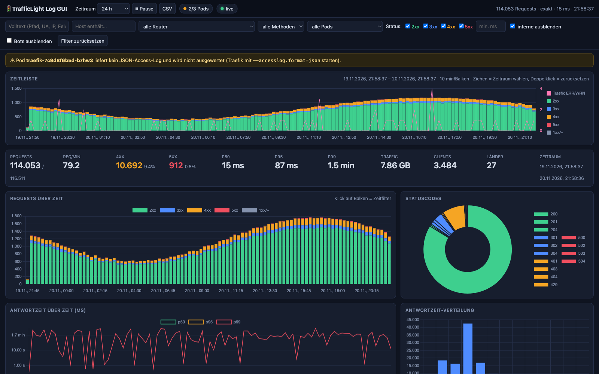

# Traefik Log GUI

Grafische Auswertung der Traefik-Access-Logs – läuft im Kubernetes Cluster, liest die Logs **aller
Traefik-Pods** fortlaufend ein, speichert sie in **Redis (max. 90 Tage)** und aktualisiert
die Oberfläche live per **Server-Sent Events**.



Weitere Screenshots: [komplette Seite](docs/screenshots/02-uebersicht-24h-komplett.png) ·
[Live-Requests](docs/screenshots/03-live-requests-15min.png) ·
[30 Tage](docs/screenshots/04-30-tage-voraggregiert.png) ·
[90 Tage](docs/screenshots/05-90-tage.png) ·
[Filter](docs/screenshots/06-filter-fehler-host.png) ·
[Zoom per Zeitleiste](docs/screenshots/07-zeitleiste-zoom.png) ·
[dynamische Felder](docs/screenshots/08-dynamische-felder.png) ·
[Rohdaten eines Requests](docs/screenshots/09-request-details-rohdaten.png) ·
[Systemlogs, Pods & Speicher](docs/screenshots/10-systemlogs-pods-speicher.png)
(Die Screenshots zeigen simulierte Beispieldaten, siehe „Lokale Entwicklung“.)

## Aufbau

```
Traefik-Pods ──(Kubernetes-API: Pod-Logs)──▶ traefikgui ──▶ Redis (StatefulSet + Volume)
                                                 │
                                    Browser ◀── SSE / JSON-API
```

| Pfad | Inhalt |
|---|---|
| `k8s` | Kubernetes-Manifeste |
| `app/` | Go-Quellcode, Dockerfile, Makefile |
| `docs/screenshots/` | Screenshots der GUI |

## Funktionen

- **Sprache**: Deutsch, Englisch, Spanisch und Französisch lassen sich im Kopfbereich sofort
  umschalten. Die Auswahl wird lokal im Browser gespeichert; ohne gespeicherte Auswahl wird
  die Browsersprache verwendet, andernfalls Deutsch.
- **Mehrere Traefik-Pods**: alle Pods, die zu `TRAEFIK_SELECTOR` passen, werden gelesen; neue,
  neu gestartete und entfernte Pods werden automatisch erkannt (inkl. der Logs der vorherigen
  Container-Instanz nach einem Neustart). Je Pod merkt sich ein Cursor in Redis die zuletzt
  verarbeitete Zeile – nach einem Neustart von traefikgui oder Redis wird lückenlos und ohne
  Duplikate fortgesetzt. Filter und Top-Liste „Traefik-Pods“ zeigen die Verteilung.
- **Nur JSON**: verarbeitet werden ausschließlich Zeilen im JSON-Format
  (`--accesslog.format=json`). Text-/CLF-Zeilen werden nie ausgewertet; liefert ein Pod gar kein
  JSON, wird sein Stream beendet, der Pod in der GUI als „kein JSON“ markiert und alle 5 Minuten
  erneut geprüft. Traefik-**Systemlogs** erscheinen nur, wenn Traefik sie als JSON schreibt
  (`--log.format=json`).
- **Dynamische Felder**: alle zusätzlichen Felder der JSON-Zeile (z. B. per
  `--accesslog.fields.headers.names.Referer=keep` aufgenommene Header `request_*`,
  `downstream_*`, `origin_*` oder eigene Felder) werden automatisch erkannt, sind als Top-Liste
  auswertbar, filterbar, im Volltext durchsuchbar und als Tabellenspalte einblendbar. Der
  vollständige Original-Eintrag bleibt erhalten (Klick auf eine Tabellenzeile).
- **Auswertungen**: KPIs (Requests, Req/min, 4xx/5xx, p50/p95/p99, Traffic, Clients, Länder),
  Zeitleiste mit Zoom (Ziehen), Requests/Latenz/Traffic über Zeit, Statuscodes, Methoden,
  Protokolle, Latenzverteilung, Top Hosts, Router/Services, Pfade, langsamste Pfade,
  Fehler-Pfade, Länder, Client-IPs, User-Agents, Request-Tabelle (sortierbar), CSV-Export,
  Systemlogs, Zustand der Pods und des Speichers. Klick auf Einträge setzt Filter; die Ansicht
  steht vollständig in der URL (teilbar).
- **Live per SSE**: der Browser hält eine Verbindung (`/api/stream`) und erhält darüber neue
  Auswertungen, neue Tabellenzeilen, Systemlogs und den Pod-Status. Tabs im Hintergrund geben
  die Verbindung nach 30 s frei und verbinden sich beim Zurückkehren neu.
- **Länder** offline über [DB-IP Lite](https://db-ip.com) (CC BY 4.0). Die Datenbank liegt im
  Image (Stand: Build-Monat) – es werden keine IPs an externe Dienste gesendet. Für aktuelle
  Daten das Image gelegentlich neu bauen.

## Speicherung und Performance

Der Browser bekommt nie Rohdaten in Masse, sondern fertige Aggregate; die Request-Tabelle
rendert nur die sichtbaren Zeilen und lädt beim Scrollen nach.

| Ebene | Redis | Aufbewahrung | dient für |
|---|---|---|---|
| Einzel-Requests | `tg:raw:<stunde>` (Liste), abgeschlossene Stunden gzip-verdichtet in `tg:rawz:<stunde>` (~100 Byte/Request) | `RAW_RETENTION_DAYS` | Pfade, Clients, User-Agents, dynamische Felder, Volltext, Tabelle, Rohdaten |
| Voraggregation | `tg:cube:<m\|h\|d>:…` je Minute (48 h), Stunde und Tag über Host, Service, Router, Methode, Status, Protokoll, Land, Pod | `RETENTION_DAYS` | Zeitreihen, KPIs, Latenz-Perzentile, Hosts, Services, Länder – auch gefiltert |
| Systemlogs | `tg:sys:<tag>` | `RETENTION_DAYS` | Systemlog-Tabelle, Warnungen in der Zeitleiste |

- Passt der gewählte Zeitraum ins Detail-Budget (`DETAIL_MAX_ENTRIES`), wird **alles exakt**
  aus den Einzel-Requests berechnet. Größere Zeiträume kommen aus der Voraggregation
  (vollständig und exakt für Zähler; Perzentile aus Histogrammen, ±13 %), nur die
  Einzel-Request-Listen beziehen sich dann auf den jüngsten Teil des Zeitraums – die GUI
  weist darauf hin.
- Alle Schlüssel haben ein Ablaufdatum; mehr als 90 Tage lassen sich nicht einstellen.
- Wird Redis knapp (`REDIS_MEMORY_HIGH_PCT` von `maxmemory`), verdichtet traefikgui zuerst und
  verwirft dann die **ältesten Einzel-Requests**; die Voraggregation bleibt erhalten.
- Als Zeitpunkt eines Requests gilt sein Ende (Zeitpunkt, an dem Traefik die Zeile schreibt) –
  wichtig bei lang laufenden Streams.

Messwerte mit simulierten Daten (16-Kern-Notebook, Redis auf 512 MB begrenzt, 3,5 Mio.
Requests über 30 Tage, `DETAIL_MAX_ENTRIES=500000`): Einlesen 15 000–35 000 Zeilen/s ·
24 h (115 000 Requests) exakt in ~10 ms, beim ersten Aufruf nach einem Neustart 1,2 s ·
7 Tage beim ersten Aufruf 2,1 s · 30 Tage in ~55 ms und 90 Tage in ~45 ms (Cache gefüllt) ·
40 s Lasttest mit 24 parallelen Clients über alle Endpunkte: 16 000 Anfragen, längste 1,9 s ·
Arbeitsspeicher traefikgui 400–570 MB (`GOMEMLIMIT=600MiB`).

**Dimensionierung:** 512 MB Redis reichen für ca. 3,5 Mio. Requests im Detail. Für mehr
`--maxmemory` und `resources.limits.memory` in `../traefiklight/redis` gemeinsam erhöhen.
Der Arbeitsspeicher von traefikgui hängt an `DETAIL_MAX_ENTRIES` (~175 MB je Million, plus
~250 MB Grundbedarf/Reserve); `GOMEMLIMIT` entsprechend unter dem Container-Limit halten.

## Deployment


| Datei | Zweck |
|---|---|
| `k8s/Namespace.yml` | Namespace `monitoring` |
| `k8s/Deployment.yml` | traefikgui (1 Replica, `Recreate` – es darf nur einen Schreiber geben) |
| `k8s/ServiceAccount.yml` | ServiceAccount (Pull-Secret `yoursecretname`) |
| `k8s/RBAC.yml` | Leserechte auf `pods` und `pods/log` im Namespace `default` (Traefik) |
| `k8s/Service.yml` | ClusterIP `traefikgui:8080` |
| `k8s/traefikIngressRoute.yml` + Middlewares | `https://www.yourdomain.tld/trafficlight/dashboard/`|
| `k8s/redis` | Redis 8 mit 5-Gi-Volume (AOF), `noeviction` |
| `k8s/NetworkPolicies.yml` | Namespace default-deny; traefikgui nur von Traefik, Redis nur von traefikgui erreichbar |
| `k8s/SlackAlertTraefikguiImageRepository.yml` | Slack-Hinweis bei neuem Image |

Reihenfolge beim ersten Ausrollen:

1. Image bauen und in die Registry legen (siehe unten) – sonst startet der Pod nicht
   (`ImagePullBackOff`, heilt sich selbst, sobald das Image existiert).
2. Optional ein Redis-Passwort setzen (ohne Secret läuft Redis ohne Passwort und ist allein
   per NetworkPolicy abgeschottet):
   `kubectl -n monitoring create secret generic traefikgui --from-literal=REDIS_PASSWORD="$(openssl rand -hex 24)"`
3. Änderungen committen und pushen.

Zugriff: `https://www.yourdomain.tld/trafficlight/dashboard/` oder ohne Ingress:

```bash
kubectl -n monitoring port-forward svc/traefikgui 8787:8080
# -> http://127.0.0.1:8787
```

Die Access-Logs enthalten Client-IPs. Die GUI hat bewusst keine eigene Anmeldung; von außen
ist sie nur über die IngressRoute mit Basic Auth erreichbar. Alle Pfade der GUI sind relativ,
sie funktioniert daher hinter dem Pfad-Präfix.

### Konfiguration (Umgebungsvariablen)

| Variable | Standard | Beschreibung |
|---|---|---|
| `TRAEFIK_NAMESPACES` | `default` | Namespaces der Traefik-Pods (kommagetrennt; je Namespace Role + RoleBinding nötig) |
| `TRAEFIK_SELECTOR` | `app=traefik` | Label-Selector der Traefik-Pods |
| `TRAEFIK_CONTAINER` | – | nur diesen Container lesen (Standard: alle Container des Pods) |
| `BACKFILL` | `true` | beim ersten Kontakt mit einem Pod dessen vorhandene Logs vollständig einlesen |
| `RETENTION_DAYS` | `90` | Aufbewahrung der Auswertungen, 1–90 |
| `RAW_RETENTION_DAYS` | = `RETENTION_DAYS` | Aufbewahrung der Einzel-Requests |
| `DETAIL_MAX_ENTRIES` | `1000000` (Deployment: `500000`) | Budget für exakte Detail-Auswertungen im Arbeitsspeicher |
| `REDIS_ADDR` / `REDIS_PASSWORD` / `REDIS_DB` / `REDIS_PREFIX` | `localhost:6379` / – / `0` / `tg:` | Redis-Verbindung |
| `REDIS_MEMORY_HIGH_PCT` | `85` | ab dieser Auslastung von `maxmemory` werden die ältesten Einzel-Requests verworfen |
| `GEOIP_DB` | im Image gesetzt | Pfad zur DB-IP-Lite-CSV (`.csv.gz`); leer = keine Länder |
| `LISTEN_ADDR` | `:8080` | HTTP-Adresse |
| `LOG_LEVEL` / `LOG_FORMAT` | `info` / `json` | Logging |
| `KUBE_API_URL` / `KUBE_TOKEN_FILE` / `KUBE_CA_FILE` | In-Cluster | abweichende Kubernetes-API (Entwicklung) |
| `PPROF_ADDR` | – | Profiling-Endpunkt zur Fehlersuche, z. B. `127.0.0.1:6060` |


## Image bauen

Voraussetzung: Go wird nicht lokal benötigt, nur Docker mit buildx.

```bash
cd app
make test     # go vet + Tests (mit lokalem Go)
make test-frontend # Übersetzungstests (mit lokalem Node.js)
make image    # baut linux/amd64 + linux/arm64 in ein OCI-Archiv (ohne Push)
make push     # baut und pusht registry.yourdomain.tld/datenschleuder/traefikgui:$(cat VERSION)
```

Alternativ baut der GitHub-Workflow `traefikgui-image.yml` das Image automatisch, sobald sich
auf `main` etwas unter `app/` ändert. Der Tag steht in `app/VERSION` (existierende Tags werden
nicht überschrieben – für ein neues Image `VERSION` erhöhen).

## Lokale Entwicklung

Ohne Cluster, mit simulierten Traefik-Pods (zwei mit JSON-Logs, einer mit Text-Logs):

```bash
cd app
make dev      # Redis-Container + fakekube + traefikgui -> http://127.0.0.1:8787
```

`cmd/fakekube` simuliert die Kubernetes-API (Pod-Liste, Log-Streams) mit deterministischen
Beispieldaten; `-history 720h -rate 1` erzeugt z. B. 30 Tage Historie.
Gegen einen echten Cluster: `kubectl proxy` starten und `KUBE_API_URL=http://127.0.0.1:8001` setzen.


## Kontakt:

Wenn Sie die Software nutzen, freuen wir uns über Feedback, Verbesserungsvorschläge, Fehlerberichte und
ihre Erfahrung mit der Software im täglischen Einsatz. Bitte melden Sie sich bei uns unter [https://www.playme.berlin/hilfe](https://www.playme.berlin/hilfe)`