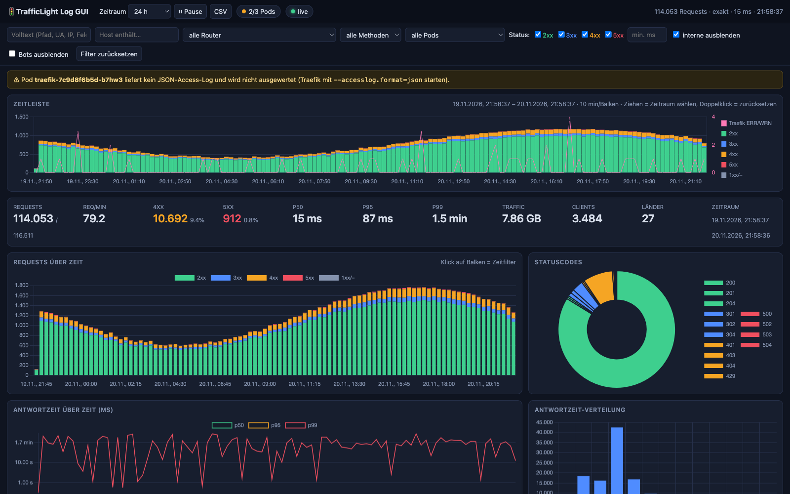

# Traefik Log GUI

Graphical analysis of Traefik access logs – runs in a Kubernetes cluster, continuously reads the logs of **all
Traefik pods**, stores them in **Redis (maximum 90 days)**, and updates
the UI live via **Server-Sent Events**.



More screenshots: [full page](docs/screenshots/02-uebersicht-24h-komplett.png) ·
[live requests](docs/screenshots/03-live-requests-15min.png) ·
[30 days](docs/screenshots/04-30-tage-voraggregiert.png) ·
[90 days](docs/screenshots/05-90-tage.png) ·
[filters](docs/screenshots/06-filter-fehler-host.png) ·
[timeline zoom](docs/screenshots/07-zeitleiste-zoom.png) ·
[dynamic fields](docs/screenshots/08-dynamische-felder.png) ·
[raw request data](docs/screenshots/09-request-details-rohdaten.png) ·
[system logs, pods & storage](docs/screenshots/10-systemlogs-pods-speicher.png)
(The screenshots show simulated example data; see “Local development”.)

## Architecture

```
Traefik pods ──(Kubernetes API: pod logs)──▶ traefikgui ──▶ Redis (StatefulSet + volume)
                                                    │
                                       Browser ◀── SSE / JSON API
```

| Path | Content |
|---|---|
| `k8s` | Kubernetes manifests |
| `app/` | Go source code, Dockerfile, Makefile |
| `docs/screenshots/` | GUI screenshots |

## Features

- **Language**: German, English, Spanish, and French can be switched immediately in the header.
  The selection is stored locally in the browser; if no selection is saved, the browser language
  is used, otherwise German.
- **Multiple Traefik pods**: all pods matching `TRAEFIK_SELECTOR` are read; new, restarted, and
  removed pods are detected automatically (including logs from the previous container instance
  after a restart). Redis stores a cursor for each pod with the last processed line. After a
  restart of traefikgui or Redis, processing continues without gaps or duplicates. Filters and
  the “Traefik pods” top list show the distribution.
- **JSON only**: only lines in JSON format (`--accesslog.format=json`) are processed.
  Text/CLF lines are never evaluated. If a pod produces no JSON, its stream is stopped, the pod
  is marked “no JSON” in the UI, and it is checked again every 5 minutes. Traefik **system logs**
  appear only if Traefik writes them as JSON (`--log.format=json`).
- **Dynamic fields**: all additional fields in the JSON line (for example, headers collected by
  `--accesslog.fields.headers.names.Referer=keep`, `request_*`, `downstream_*`, `origin_*`, or
  custom fields) are detected automatically, can be evaluated as top lists, filtered, searched
  in the full text, and shown as table columns. The complete original entry is preserved (click
  a table row).
- **Analysis**: KPIs (requests, req/min, 4xx/5xx, p50/p95/p99, traffic, clients, countries),
  timeline with zoom (drag), requests/latency/traffic over time, status codes, methods,
  protocols, latency distribution, top hosts, routers/services, paths, slowest paths,
  error paths, countries, client IPs, user agents, request table (sortable), CSV export,
  system logs, pod status, and storage status. Clicking entries sets filters; the complete view
  is represented in the URL and can be shared.
- **Live via SSE**: the browser maintains a connection (`/api/stream`) and receives new analysis
  results, new table rows, system logs, and pod status updates. Background tabs release the
  connection after 30 seconds and reconnect when they become active again.
- **Countries**: offline lookup through [DB-IP Lite](https://db-ip.com) (CC BY 4.0). The database
  is included in the image (build month) – no IPs are sent to external services. Rebuild the
  image periodically for current data.

## Storage and performance

The browser never receives bulk raw data, only completed aggregates. The request table renders
only visible rows and loads more as the user scrolls.

| Level | Redis | Retention | Used for |
|---|---|---|---|
| Individual requests | `tg:raw:<hour>` (list), completed hours gzip-compressed in `tg:rawz:<hour>` (~100 bytes/request) | `RAW_RETENTION_DAYS` | Paths, clients, user agents, dynamic fields, full-text search, table, raw data |
| Preaggregation | `tg:cube:<m\|h\|d>:…` per minute (48 h), hour, and day across host, service, router, method, status, protocol, country, and pod | `RETENTION_DAYS` | Time series, KPIs, latency percentiles, hosts, services, countries – also when filtered |
| System logs | `tg:sys:<day>` | `RETENTION_DAYS` | System log table, warnings in the timeline |

- If the selected period fits within the detail budget (`DETAIL_MAX_ENTRIES`), **everything** is
  calculated exactly from the individual requests. Longer periods use preaggregated data
  (fully exact for counters; percentiles from histograms, ±13%). The individual-request lists
  then cover only the most recent part of the period – the GUI indicates this.
- Every key has an expiry date; settings cannot exceed 90 days.
- If Redis becomes constrained (`REDIS_MEMORY_HIGH_PCT` of `maxmemory`), traefikgui first
  compresses data and then discards the **oldest individual requests**; preaggregated data is
  retained.
- A request’s timestamp is the time it ends (the time Traefik writes the line) – important for
  long-running streams.

Benchmark values with simulated data (16-core laptop, Redis limited to 512 MB, 3.5 million
requests over 30 days, `DETAIL_MAX_ENTRIES=500000`): ingestion 15,000–35,000 lines/s ·
24 h (115,000 requests) exact in ~10 ms, 1.2 s on the first call after a restart ·
7 days 2.1 s on the first call · 30 days ~55 ms and 90 days ~45 ms (cache populated) ·
40-second load test with 24 parallel clients across all endpoints: 16,000 requests, longest
1.9 s · traefikgui memory 400–570 MB (`GOMEMLIMIT=600MiB`).

**Sizing:** 512 MB of Redis is sufficient for approximately 3.5 million requests in detail.
For larger workloads, increase `--maxmemory` and `resources.limits.memory` in
`../traefiklight/redis` together. traefikgui memory use depends on `DETAIL_MAX_ENTRIES`
(~175 MB per million requests, plus ~250 MB baseline/reserve); set `GOMEMLIMIT` below the
container limit.

## Deployment

| File | Purpose |
|---|---|
| `k8s/Namespace.yml` | Namespace `monitoring` |
| `k8s/Deployment.yml` | traefikgui (1 replica, `Recreate` – only one writer is allowed) |
| `k8s/ServiceAccount.yml` | Service account (pull secret `yoursecretname`) |
| `k8s/RBAC.yml` | Read access to `pods` and `pods/log` in the `default` namespace (Traefik) |
| `k8s/Service.yml` | ClusterIP `traefikgui:8080` |
| `k8s/traefikIngressRoute.yml` + middlewares | `https://www.yourdomain.tld/trafficlight/dashboard/` |
| `k8s/redis` | Redis 8 with 5-Gi volume (AOF), `noeviction` |
| `k8s/NetworkPolicies.yml` | Namespace default-deny; traefikgui accessible only from Traefik, Redis only from traefikgui |
| `k8s/SlackAlertTraefikguiImageRepository.yml` | Slack notification for a new image |

Order for the initial rollout:

1. Build the image and place it in the registry (see below) – otherwise the pod will not start
   (`ImagePullBackOff`, and it recovers once the image exists).
2. Optionally set a Redis password (without a secret, Redis runs without a password and is
   isolated solely by the network policy):
   `kubectl -n monitoring create secret generic traefikgui --from-literal=REDIS_PASSWORD="$(openssl rand -hex 24)"`
3. Commit and push the changes.

Access: `https://www.yourdomain.tld/trafficlight/dashboard/`, or without an ingress:

```bash
kubectl -n monitoring port-forward svc/traefikgui 8787:8080
# -> http://127.0.0.1:8787
```

The access logs contain client IPs. The GUI intentionally has no built-in login; externally,
it is accessible only through the IngressRoute with Basic Auth. All GUI paths are relative,
so it works behind a path prefix.

### Configuration (environment variables)

| Variable | Default | Description |
|---|---|---|
| `TRAEFIK_NAMESPACES` | `default` | Namespaces of the Traefik pods (comma-separated; each namespace requires a Role and RoleBinding) |
| `TRAEFIK_SELECTOR` | `app=traefik` | Label selector for Traefik pods |
| `TRAEFIK_CONTAINER` | – | Read only this container (default: all containers in the pod) |
| `BACKFILL` | `true` | When first connecting to a pod, read all of its existing logs |
| `RETENTION_DAYS` | `90` | Retention for analysis data, 1–90 |
| `RAW_RETENTION_DAYS` | = `RETENTION_DAYS` | Retention for individual requests |
| `DETAIL_MAX_ENTRIES` | `1000000` (deployment: `500000`) | Memory budget for exact detail analysis |
| `REDIS_ADDR` / `REDIS_PASSWORD` / `REDIS_DB` / `REDIS_PREFIX` | `localhost:6379` / – / `0` / `tg:` | Redis connection |
| `REDIS_MEMORY_HIGH_PCT` | `85` | At this utilization of `maxmemory`, the oldest individual requests are discarded |
| `GEOIP_DB` | Set in the image | Path to the DB-IP Lite CSV (`.csv.gz`); empty = no countries |
| `LISTEN_ADDR` | `:8080` | HTTP address |
| `LOG_LEVEL` / `LOG_FORMAT` | `info` / `json` | Logging |
| `KUBE_API_URL` / `KUBE_TOKEN_FILE` / `KUBE_CA_FILE` | In-cluster | Alternative Kubernetes API (development) |
| `PPROF_ADDR` | – | Profiling endpoint for troubleshooting, for example `127.0.0.1:6060` |

## Build the image

Prerequisites: Go is not required locally, only Docker with buildx.

```bash
cd app
make test     # go vet + tests (with local Go)
make test-frontend # translation tests (with local Node.js)
make image    # builds linux/amd64 + linux/arm64 into an OCI archive (without pushing)
make push     # builds and pushes registry.yourdomain.tld/datenschleuder/traefikgui:$(cat VERSION)
```

Alternatively, the GitHub workflow `traefikgui-image.yml` builds the image automatically whenever
something under `app/` changes on `main`. The tag is defined in `app/VERSION` (existing tags are
not overwritten – increase `VERSION` for a new image).

## Local development

Without a cluster, using simulated Traefik pods (two with JSON logs, one with text logs):

```bash
cd app
make dev      # Redis container + fakekube + traefikgui -> http://127.0.0.1:8787
```

`cmd/fakekube` simulates the Kubernetes API (pod list and log streams) with deterministic example
data; `-history 720h -rate 1` generates 30 days of history, for example.
To use a real cluster, start `kubectl proxy` and set
`KUBE_API_URL=http://127.0.0.1:8001`.

## Contact

If you use the software, we would appreciate feedback, suggestions for improvement, bug reports,
and your experience using the software in daily operation. Please contact us at
[https://www.playme.berlin/support](https://www.playme.berlin/support)
